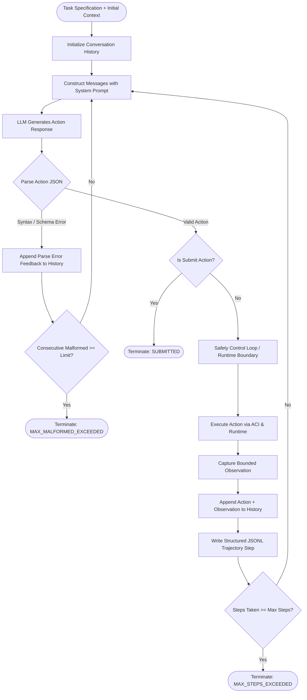

# Agent & Agent-Computer Interface (ACI) Architecture

This document specifies the architectural design of **Member 1: SWE-agent-Style Coding Agent & ACI** for the project **"Autonomous Reversibility of Antipatterns in LLM-Assisted Code Generation"**.

---

## 1. Research Reference & Design Philosophy

Our design is conceptually inspired by:

> **SWE-agent: Agent-Computer Interfaces Enable Automated Software Engineering**  
> NeurIPS 2024, by John Yang, Carlos E. Jimenez, Alexander Wettig, Kilian Lieret, Shunyu Yao, Karthik Narasimhan, Ofir Press.

The core insight of SWE-agent is that language models struggle when interacting with software repositories via unstructured, raw bash shells alone. Designing a customized **Agent-Computer Interface (ACI)** with structured navigation, line-numbered viewing, surgical editing, and bounded output dramatically improves agent success rates and minimizes token waste.

In our B.Tech research project, we preserve SWE-agent's foundational mechanics while introducing an explicit **Declared Scope Contract** on every agent action. This allows an external safety control loop (Policy Limiter, Transactional Sandbox, Ground-Truth Auditor, and Scope Comparator) to audit the agent's actual system effects against its declared intent and trigger autonomous rollbacks when discrepancies or anti-patterns occur.

---

## 2. Interaction Loop

The coding agent executes a deterministic, turn-based feedback loop:



### Determinism and Error Recovery
- **Non-crashing action recovery**: If the LLM generates invalid JSON or an unrecognised action, the error message is placed directly into conversation history as system feedback, prompting the model to correct its syntax on the subsequent turn.
- **Controlled termination limits**: If consecutive malformed actions exceed a configurable threshold (`max_consecutive_malformed_actions`, default: 3), execution terminates safely with `status="MAX_MALFORMED_EXCEEDED"` instead of burning tokens in an infinite loop.
- **Budget enforcement**: If the agent reaches `max_steps` without calling `submit`, it terminates with `status="MAX_STEPS_EXCEEDED"` and `submitted=False`. Reaching the step limit is **never** counted as a successful resolution.

---

## 3. Agent-Computer Interface (ACI) Commands

The minimal ACI provides 5 focused actions:

| Action Name | Primary Arguments | Description | Bounded Behavior |
| :--- | :--- | :--- | :--- |
| `search` | `query: str`, `path: str?` | Text search across repository files | Returns file paths and line numbers; capped at max matches and character limit. Traversal outside workspace (`..`) is rejected. |
| `read_file` | `path: str`, `start_line: int?`, `end_line: int?` | Read file lines with 1-indexed numbers | Returns window or range with 1-based indexing (`12: def foo():`). Truncates if line count exceeds bounds. Traversal (`..`) rejected. |
| `edit_file` | `path: str`, `content: str?`, `old_str: str?`, `new_str: str?`, `replacement_text: str?` | Surgically modify repository files | Supports: (1) full write/create, (2) unique substring replacement, or (3) line-range replacement. Rejects non-unique matches and path traversal. |
| `run_shell` | `command: str` | Execute bash command in container | Runs strictly through the `Runtime` abstraction. Returns exit code and bounded stdout/stderr. Host execution is strictly forbidden. |
| `submit` | `summary: str?` | Signal completion and submission | Explicitly terminates the agent loop. Does **not** determine task correctness. Task verification is delegated to the external benchmark evaluator. |

---

## 4. Declared Scope Schema & Auditor Boundary

Every action generated by the agent must declare its intended effects before execution:

```json
{
  "action": "edit_file",
  "args": {
    "path": "src/calculator.py",
    "old_str": "return a - b",
    "new_str": "return a + b"
  },
  "declared_scope": {
    "write": ["src/calculator.py"],
    "read": ["tests/test_calc.py"],
    "network": false
  }
}
```

### Schema Definition
- `write: List[str]`: Files the agent intends to create, modify, or delete.
- `read: List[str]`: Files the agent intends to read or inspect.
- `network: bool`: Whether external network access is required.

### Critical Boundary: Declaration $\neq$ Authorization
- The agent's `declared_scope` is **untrusted intent**. It is metadata describing what the agent claims it will do.
- Member 1's code does **not** evaluate whether the command actually conforms to reality, nor does it decide whether to commit or rollback container changes.
- The declaration is passed directly to the `ToolCall` contract consumed by Member 2 (Transactional Docker Runtime), Member 3 (Ground-Truth Auditor), and Member 4 (Scope Comparator).

---

## 5. Runtime Interface Contract (Handoff to Member 2)

The agent interacts exclusively with an isolated environment conforming to the `Runtime` protocol:

```python
from typing import Protocol, Optional
from src.agent.models import Action, Observation
from src.models import ExecutionResult

class Runtime(Protocol):
    def execute(self, action: Action) -> Observation:
        """Execute an ACI Action and return an Observation."""
        ...

    def execute_shell(self, command: str, timeout: Optional[float] = None) -> ExecutionResult:
        """Run a shell command inside the container environment."""
        ...

    def read_file(self, path: str) -> str:
        """Read a file from the workspace filesystem."""
        ...

    def write_file(self, path: str, content: str) -> None:
        """Write content to a file in the workspace filesystem."""
        ...

    def file_exists(self, path: str) -> bool:
        """Check file existence."""
        ...

    def list_files(self, directory: str = ".") -> list[str]:
        """List files relative to workspace."""
        ...
```

### Runtime Expectations for Member 2 (Docker Container)
1. **Container Isolation**: `execute_shell` and file operations must occur inside the container (`/workspace`), never on the host.
2. **Strace & Container Diff Tracking**: Member 2 wraps tool calls with syscall/filesystem monitoring.
3. **Structured Observation**: Returns exit code, stdout, and stderr as a standard `Observation`.
4. **Deterministic Testing**: For unit and CI testing, `FakeRuntime` provides a completely in-memory, zero-dependency environment without Docker daemon requirements.

---

## 6. History Management & Truncation Handling

The `AgentHistory` module maintains conversation integrity across turns:
- **System and Task Preservation**: Index 0 (system instructions) and Index 1 (original task instruction and context) are **permanently pinned** and never pruned.
- **Sliding Turn Window**: When conversation turns exceed `max_history_turns`, oldest intermediate turn pairs (assistant action + observation) are pruned to keep LLM context within token bounds.
- **Explicit Truncation Logging**: Any observation output exceeding `max_observation_chars` is truncated with an explicit annotation (e.g. `... [Output truncated: 4200 characters omitted] ...`) and logged via `logging.getLogger`. No silent data loss is permitted.

---

## 7. Trajectory Logging & Secret Redaction

Agent trajectories are saved as structured JSON Lines (`.jsonl`) files in `logs/trajectories/trajectory_<task_id>.jsonl`.

### JSONL Record Schema
```json
{
  "experiment_id": "btech_reversibility_eval_v1",
  "task_id": "task_bug_42",
  "step": 3,
  "timestamp": "2026-10-15T12:00:00.000000+00:00",
  "model": "mock-swe-agent-v1",
  "action_type": "edit_file",
  "action_args": {"path": "calculator.py", "old_str": "...", "new_str": "..."},
  "declared_scope": {"write": ["calculator.py"], "read": [], "network": false},
  "observation_success": true,
  "observation_output": "Successfully replaced text in 'calculator.py'",
  "observation_error": null,
  "token_usage": {"prompt_tokens": 420, "completion_tokens": 65, "total_tokens": 485},
  "cost_usd": null,
  "is_terminal": false,
  "termination_reason": null
}
```

### Secret Redaction Policy
All strings, dictionaries, tool arguments, and observation outputs pass through `redact_secrets()` before being committed to trajectory logs. Regular expressions identify and mask:
- OpenAI keys (`sk-...`)
- GitHub tokens (`ghp_...`)
- Bearer authorization headers (`Bearer ...`)
- Generic API keys, tokens, and passwords (`SECRET_...`, `api_key=...`)
Masked secrets are replaced with `[REDACTED_SECRET]`.
