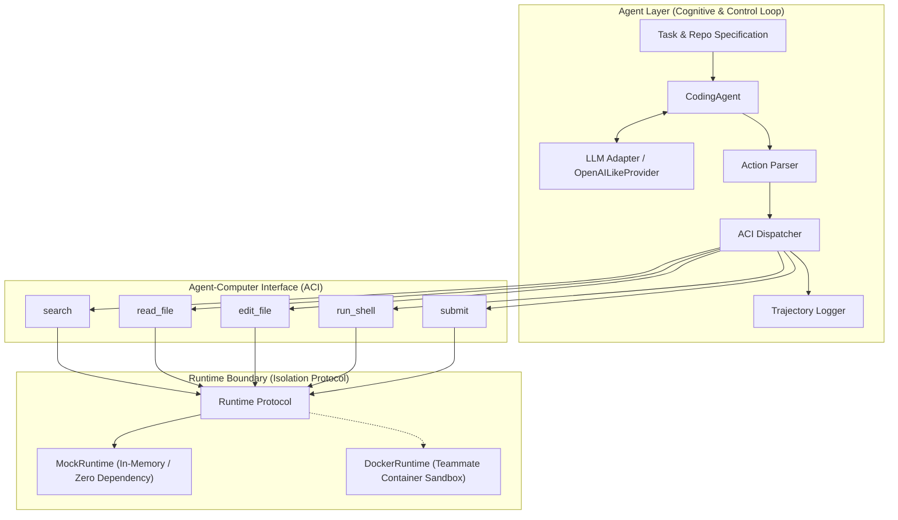

# Baseline Architecture: Coding Agent & Runtime Sandbox

## 1. Architectural Overview

The baseline system implements a modular, reproducible software engineering agent inspired by **SWE-agent (Yang et al., NeurIPS 2024)**. It isolates the cognitive LLM reasoning loop from the physical repository filesystem via a strict **Runtime Abstraction Boundary**.



---

## 2. Core Components

### A. Coding Agent (`src/agent/agent.py`)
- **Lifecycle Management**:
  1. Invokes `runtime.start(repository, task)` to prepare the isolated workspace.
  2. Builds system prompt and conversation messages with pinned task context.
  3. Executes turn-based ReAct loop (LLM $\rightarrow$ parse action $\rightarrow$ dispatch tool $\rightarrow$ observe).
  4. Guarantees environment cleanup via `try ... finally: runtime.stop()`.
  5. On completion or budget exhaustion, gathers `final_diff` via `runtime.get_changes()` and verifies tests via `runtime.run_tests()`.
- **Termination Conditions**:
  - `SUBMITTED`: Agent called `submit` action with task summary.
  - `MAX_STEPS_EXCEEDED`: Step count reached budget (`max_steps`). Never reported as solved.
  - `MAX_MALFORMED_EXCEEDED`: LLM produced repeated unparseable output beyond threshold (`max_consecutive_malformed_actions`).
  - `ERROR`: Unrecoverable LLM or system exception.

### B. LLM Adapter (`src/agent/llm.py`)
- **`LLMProvider`**: Abstract provider interface completely decoupled from agent control logic.
- **`MockLLMProvider`**: Deterministic mock provider supporting scripted sequences and exception injection for fast, offline CI tests.
- **`OpenAILikeProvider`**: Lightweight, standard library (`urllib`)-based HTTP client compatible with OpenAI, Ollama, vLLM, and OpenRouter chat completions APIs.
- **Credential Safety**: Loads API keys exclusively through environment variables (e.g. `OPENAI_API_KEY`). Redacts all secrets before logging.
- **Cost & Token Tracking**: Accumulates `prompt_tokens`, `completion_tokens`, and `total_tokens` across steps.

### C. Agent-Computer Interface (ACI) (`src/agent/aci/`)
Exposes 5 specialized operations instead of exposing raw unrestricted host bash:

| Tool | Parameters | Functionality | Safety / Bounds |
| :--- | :--- | :--- | :--- |
| `search` | `query: str`, `path: str?` | Grep text search across workspace | Max match limit, path traversal rejection |
| `read_file` | `path: str`, `start_line: int?`, `end_line: int?` | 1-based line numbered file inspection | Slice boundaries, window truncation |
| `edit_file` | `path: str`, `old_str: str?`, `new_str: str?`, `content: str?` | Surgical text replacement or file creation | Rejects ambiguous non-unique matches |
| `run_shell` | `command: str` | Execute bash command in container | Exit code capture, bounded stdout/stderr |
| `submit` | `summary: str?` | Terminate loop and signal task completion | Explicit termination signal |

### D. Runtime Interface (`src/agent/runtime.py`)
Abstract protocol governing how the agent interacts with the workspace. The agent layer **never** interacts with host files or processes:
```python
class Runtime(Protocol):
    def start(self, repository: Optional[str] = None, task: Optional[Any] = None) -> None: ...
    def stop(self) -> None: ...
    def execute(self, action: Action) -> Observation: ...
    def execute_shell(self, command: str, timeout: Optional[float] = None) -> ExecutionResult: ...
    def read_file(self, path: str, start_line: Optional[int] = None, end_line: Optional[int] = None) -> str: ...
    def write_file(self, path: str, content: str) -> None: ...
    def file_exists(self, path: str) -> bool: ...
    def list_files(self, directory: str = ".") -> List[str]: ...
    def get_changes(self) -> str: ...
    def run_tests(self, command: Optional[str] = None) -> ExecutionResult: ...
```

### E. Trajectory Logger (`src/agent/logger.py`)
- Emits structured JSONL files containing step index, model name, prompt tokens, actions, observations, timestamps, and terminal reasons.
- Sanitizes all logged fields against regex secret patterns (API keys, bearer tokens, passwords).

---

## 3. Future Safety Layer Integration Point

The baseline architecture has been designed so that the teammate's safety control loop (Policy Limiter, Ground-Truth Auditor, Scope Comparator, and Rollback) can wrap the `Runtime` interface without requiring any changes to `CodingAgent` or the ACI tools:

```
[ CodingAgent ]
      │
   Action (with optional declared_scope)
      │
      ▼
[ Future Safety Interceptor ]
  ├── 1. Policy Gate (allowed / rejected)
  ├── 2. Snapshot / Transactional Sandbox
  ├── 3. Execute Action
  ├── 4. Ground-Truth Auditor (docker diff + strace)
  ├── 5. Scope Comparator (declared vs actual)
  └── 6. Commit (on match) OR Rollback (on violation)
      │
 Observation
      │
      ▼
[ CodingAgent ]
```
