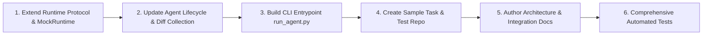

# Implementation Plan: Baseline Coding Agent & Sandbox Architecture

## 1. Project Context & Objectives
This document establishes the implementation plan for the baseline coding agent and its sandbox integration boundary for the B.Tech final-year project:
**"Autonomous Reversibility of Anti-Patterns in LLM-Assisted Code Generation"**

### Baseline Scope
The goal of this phase is to establish a robust, minimal, and fully testable **SWE-agent-inspired baseline**:
1. An LLM-powered coding agent.
2. A deterministic turn-based interaction loop (observe $\rightarrow$ reason $\rightarrow$ act).
3. A minimal Agent-Computer Interface (ACI) (`search`, `read_file`, `edit_file`, `run_shell`, `submit`).
4. A clean, decoupled Sandbox Runtime interface (`Runtime` protocol).
5. Repository isolation semantics via a well-defined integration contract for the Docker teammate.
6. Test execution, diff tracking, and trajectory logging.
7. Zero-dependency mock runtime and offline test coverage.

> [!IMPORTANT]
> The baseline phase intentionally excludes the ground-truth auditor, scope comparator, and autonomous rollback mechanisms. These safety layers will intercept the runtime actions in subsequent phases without modifying the core agent loop.

---

## 2. Current Architecture & Codebase Inspection Findings

### A. Repository Status
- **Root Directory**: `D:\RSF_AGENTS`
- **Python Version**: Python 3.13.4
- **Dependencies**: Managed via `pyproject.toml` and `requirements.txt` (`pydantic>=2.0.0`, `docker>=7.0.0`, `pytest>=8.0.0`).
- **OpenHands Relationship**: `git grep -i "openhands"` confirms **zero** dependencies or code from OpenHands. OpenHands was analyzed as architectural reference only during initial design discussions. No framework replacement is needed.

### B. Existing Reusable Components
1. **ACI Dispatcher & Tools** (`src/agent/aci/`):
   - `read_file`: Line-numbered viewing with 1-based indexing and slice ranges (`start_line`, `end_line`).
   - `edit_file`: Surgical string replacement (`old_str`, `new_str`), line-range replacements, and full-file write.
   - `search`: Substring search across repository files with character-bounded output.
   - `run_shell`: Bounded command execution routed exclusively to `Runtime`.
   - `submit`: Explicit completion signaling.
2. **Action Parser** (`src/agent/parser.py`):
   - Robust JSON block extraction from markdown fences, XML tags, or raw JSON.
   - Alias normalization (`view_file` $\rightarrow$ `read_file`, `shell` $\rightarrow$ `run_shell`, etc.).
   - Error feedback generation for malformed actions.
3. **LLM Provider Abstraction** (`src/agent/llm.py`):
   - `LLMProvider` abstract base class.
   - `MockLLMProvider`: Deterministic responses, queueing, and error injection for offline tests.
   - `OpenAILikeProvider`: Standard library `urllib`-based client for OpenAI/vLLM/Ollama compatible endpoints without external SDK dependencies.
4. **Trajectory Logging** (`src/agent/logger.py`):
   - Structured JSONL logging with secret redaction (`OPENAI_API_KEY`, Bearer tokens).
5. **Conversation History** (`src/agent/history.py`):
   - Pinned system prompt and initial task prompt; sliding window over intermediate turns.
6. **Docker Prototype** (`Dockerfile`, `src/sandbox.py`):
   - Dockerfile based on Ubuntu 22.04 with bash, coreutils, strace, python3.
   - `TransactionalSandbox` prototype for container execution.

### C. Missing Components & Gaps Identified
1. **Runtime Interface Incomplete**:
   - `src/agent/runtime.py` defines `execute`, `execute_shell`, `read_file`, `write_file`, `file_exists`, `list_files`, but lacks:
     - `start(repository, task=None)`
     - `stop()` (environment cleanup)
     - `run_tests(command=None)`
     - `get_changes()` / `get_diff()`
2. **Lifecycle & Cleanup in Agent Loop**:
   - `CodingAgent.run()` does not initialize `runtime.start()` or wrap execution in `try ... finally: runtime.stop()`.
   - `AgentResult` does not capture the final diff or test summary.
3. **CLI Entrypoint**:
   - Missing `run_agent.py` supporting `--repo` and `--task` command-line execution.
4. **Task Definitions & Sample Repositories**:
   - Missing `tasks/task_01.json` and a concrete sample repository for local verification.
5. **Documentation & Contracts**:
   - Need `docs/architecture.md` and `docs/integration_contract.md` clearly documenting the contract for the Docker teammate.

---

## 3. Implementation Sequence

### Stage 1: Runtime Protocol & Mock Enhancement (`src/agent/runtime.py`)
- Add `start(repository: str, task: Optional[Any] = None) -> None`
- Add `stop() -> None`
- Add `run_tests(command: Optional[str] = None) -> ExecutionResult`
- Add `get_changes() -> str`
- Update `FakeRuntime` to:
  - Track started/stopped state to verify cleanup in tests.
  - Track file mutations and compute unified git-style diffs in memory.
  - Execute or mock test runs via `run_tests`.

### Stage 2: Agent Loop Lifecycle Management (`src/agent/agent.py`)
- Update `CodingAgent.run()`:
  - Ingest optional repository path.
  - Call `runtime.start(repository, task)`.
  - Wrap interaction loop in `try ... finally: runtime.stop()` ensuring container/environment cleanup occurs on normal completion, errors, or timeouts.
  - On submission or completion, collect `final_diff = runtime.get_changes()` and run verification tests `final_test = runtime.run_tests()`.
  - Attach `final_diff` and `test_result` to `AgentResult`.

### Stage 3: Data Contracts Extension (`src/agent/models.py`)
- Add `final_diff` and `test_result` fields to `AgentResult`.
- Ensure `declared_scope` remains optional so the baseline functions purely without requiring safety metadata.

### Stage 4: CLI Entrypoint (`run_agent.py`)
- Implement CLI parsing:
  - `--repo`: Target repository directory.
  - `--task`: Path to task JSON definition or inline instruction.
  - `--provider`: `mock` or `openai` (or custom endpoint).
  - `--model`: Model identifier (e.g. `gpt-4o-mini`).
  - `--max-steps`: Step budget.
  - `--log-dir`: Trajectory output directory.

### Stage 5: Sample Tasks & Verification Repo
- Create `tasks/task_01.json` containing a well-defined coding bug scenario.
- Create a test repository structure (`fixtures/sample_repo/`) for end-to-end testing.

### Stage 6: Documentation & Teammate Integration Contract
- `docs/architecture.md`: Detailed baseline component diagrams and control flow.
- `docs/integration_contract.md`: Exact specifications for the Docker teammate (how to implement `Runtime`).

### Stage 7: Automated Unit Tests
- Add unit tests across all 11 required scenarios:
  1. Valid action parsing.
  2. Malformed action rejection & feedback.
  3. Agent-loop progression with MockLLM.
  4. Dispatching actions to MockRuntime.
  5. Handling runtime errors & nonzero exit codes.
  6. LLM failures and timeout handling.
  7. Maximum step count enforcement.
  8. Trajectory logging & secret redaction.
  9. File-not-found & invalid path error handling.
  10. Final diff & test result collection.
  11. Reliable runtime cleanup on success & exceptions.

---

## 4. Teammate Integration Boundary (Docker Teammate)
The Docker teammate will implement a concrete class `DockerRuntime` conforming to the enhanced `Runtime` protocol:
- Container initialization mounting/copying the target repo into `/workspace`.
- Running commands via container `exec`.
- Computing `git diff` inside the container for `get_changes()`.
- Running container tests via `run_tests()`.
- Stopping and removing containers on `stop()`.
Neither the agent loop nor the ACI tools will need any modification when swapping `FakeRuntime` with the teammate's `DockerRuntime`.
